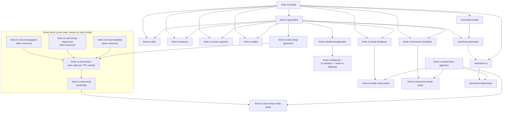
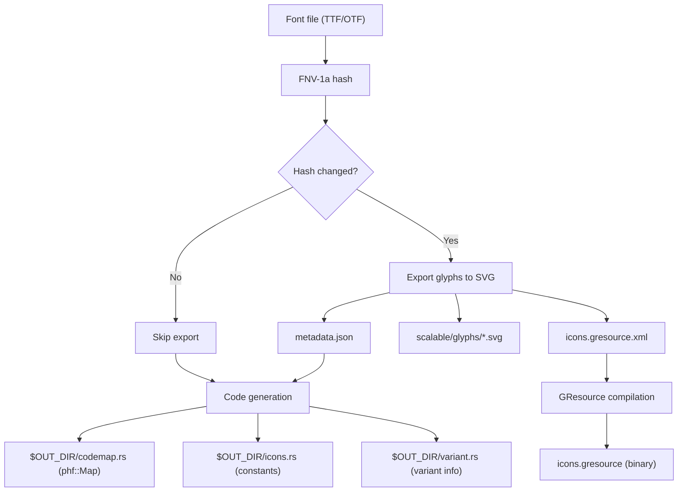
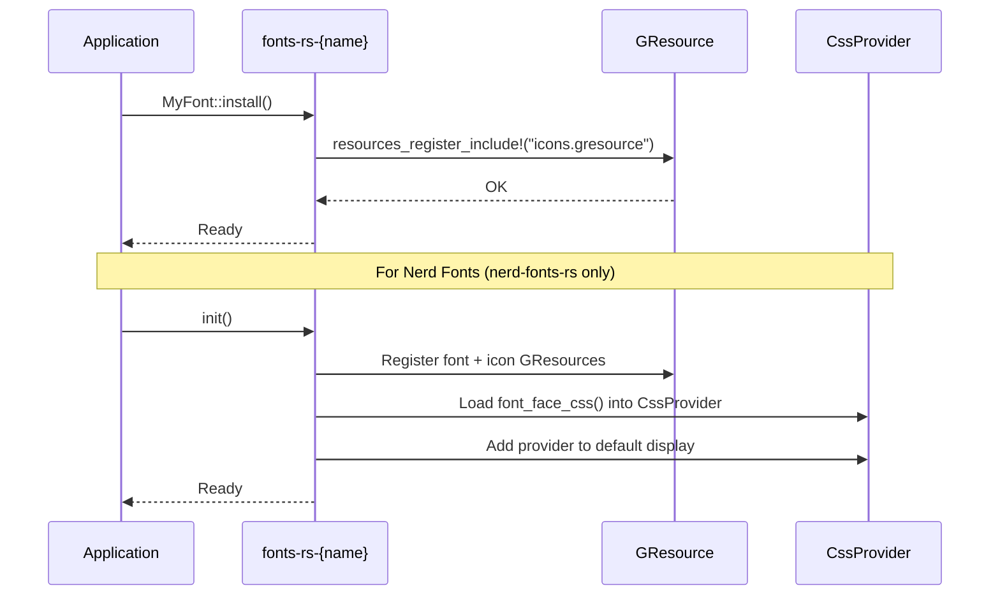

# Architecture

## Workspace Structure

The workspace is organized into four layers:

| Layer | Crates | Role |
|-------|--------|------|
| Generic framework | `fonts-rs-model`, `fonts-rs-generator`, `fonts-rs-test` | Shared types, build pipeline, test fixtures |
| Font families | `fonts-rs-doto`, `fonts-rs-bravura`, `fonts-rs-tabler`, `fonts-rs-lucide`, ... | One crate per font/icon family |
| Emoji families | `fonts-rs-noto-emoji*`, `fonts-rs-blobmoji*`, `fonts-rs-emoji-metadata` | Multi-crate families: resource + variant + umbrella + generator crates |
| Nerd Fonts | `nerd-fonts-model`, `nerd-fonts-generator`, `nerd-fonts-rs` | Nerd Fonts-specific integration |
| Applications | `fonts-rs-cheat-sheet` + `*-cheat-sheet` crates | Generic cheat sheet library + per-family apps |

## Crate Dependencies



## Build Pipeline

Each font family crate follows the same build pipeline via `FontBuild`.
Fontless icon sets (Lucide, Heroicons) use `FontBuild::svg_only()` + `run_svg()` -
same artifacts, but the input is an SVG directory and change detection
relies entirely on `extra_hash` components:



### Hash-Based Change Detection

`FontBuild` computes an FNV-1a hash of the font file and stores it in
`resources/.hash`. On subsequent builds, the hash is compared to determine
whether re-export is needed. For variable font variants, `extra_hash()`
adds the variant name to the hash, forcing re-export when the active
variant changes even if the font file is unchanged.

### Code Generation

The default code generation produces three files in `OUT_DIR`:

- **`codemap.rs`** - `phf::Map<char, &str>` (codepoint → glyph name) and
  `phf::Map<&str, char>` (glyph name → codepoint)
- **`icons.rs`** - `pub const` strings for each glyph name
- **`variant.rs`** - `GRESOURCE_PREFIX` and `GLYPH_PREFIX` constants

Custom code generation is available via `FontBuild::run_with()`.

## Font Family Crate Anatomy

Each font family crate has the following structure:

```
crates/fonts-rs-{name}/
├── Cargo.toml          # Features, dependencies, license-file
├── build.rs            # Build pipeline (FontBuild + ExportConfig)
├── resources/
│   ├── {font}.ttf      # Bundled font file
│   ├── {license}.txt   # Font license
│   └── icons.gresource.xml  # Generated by build.rs
└── src/
    ├── lib.rs          # Crate root: module wiring + re-exports
    ├── family.rs       # impl_font_family! - FontFamily + capability impls
    ├── definition.rs   # FontFamilyConfig implementation
    ├── naming.rs       # FontFamilyMarker enum + GlyphName<F> type alias
    ├── variant.rs      # include!(OUT_DIR/variant.rs)
    ├── codepoint_map.rs # include!(OUT_DIR/codemap.rs)
    ├── constants.rs    # include!(OUT_DIR/icons.rs)
    └── fonts.rs        # impl_font_loader! (optional, render feature)
```

### Emoji Families: Multi-Crate Layout

crates.io rejects package uploads larger than 10 MiB. The emoji
families ship several large TTFs plus thousands of pre-rendered color
SVGs, so each family is split into a crate topology instead of a
single crate:

```
fonts-rs-noto-emoji-glyphs       # links resource: single-codepoint SVGs
fonts-rs-noto-emoji-sequences    # links resource: multi-codepoint SVGs (ZWJ, flags, modifiers)
fonts-rs-emoji-metadata          # links resource: shared CLDR/UTS-#51 metadata
fonts-rs-noto-emoji-generator    # shared build pipeline (build-dependency)
fonts-rs-noto-emoji-{mono,color-flags,color-noflags,bitmap-flags,bitmap-noflags}
fonts-rs-noto-emoji              # umbrella: re-exports the feature-selected variant
```

Blobmoji uses the identical topology with four variants (no `mono`):
`fonts-rs-blobmoji-{color-flags,color-noflags,bitmap-flags,bitmap-noflags}`.

- **Resource crates** carry the vendored artwork and declare a `links`
  key (e.g. `links = "noto_emoji_glyphs"`); their `build.rs` prints
  `cargo:svg_dir=...`, which dependents read as
  `DEP_NOTO_EMOJI_GLYPHS_SVG_DIR`. Cargo propagates `DEP_*` variables
  only along `[dependencies]` edges - resource crates are normal
  dependencies of the variant crates, not build-dependencies. See
  [Upstream Sourcing](./upstream-sourcing.md#resource-crates).
- **Variant crates** each vendor one TTF + license file and run the
  identical export via the family generator's `build(&BuildInput)`;
  the variant is a compile-time constant per crate, so feature-based
  variant detection (`VariantList`) is not needed. `noflags` variants
  filter flag emoji at export time; `RENDERABLE` is a `pub const`
  per crate.
- **The umbrella crate** keeps the family's name
  (`fonts-rs-noto-emoji`, `fonts-rs-blobmoji`), maps variant features
  to optional dependencies and re-exports the selected variant 1:1.
  A `compile_error!` guards against enabling several variants, since
  Cargo features are additive.
- **Generators** (`fonts-rs-{family}-generator`) host the shared
  export pipeline; generic emoji machinery (CLDR parsing, ordering,
  metadata generation) lives in `fonts_rs_generator::emoji`.

Consumers keep the usual surface: `fonts-rs-noto-emoji = "0.5"` gets
the default variant; `default-features = false` +
`features = ["bitmap-flags"]` selects another. See
[Build Patterns](./build-patterns.md#pattern-3-multi-crate-emoji-family) for the
build-side details.

## Feature Gates

Each font family crate uses feature gates for optional functionality:

| Feature | Description |
|---------|-------------|
| `gtk` (default) | GResource registration, GTK4 icon name resolution |
| `render` | Font loading via `ab_glyph` for software rendering |
| `embed-fonts` | Embed font files via `include_bytes!` instead of disk |
| Variant features | One Cargo feature per font variant (e.g. `bold-dot`); for emoji umbrellas a variant feature enables a whole variant crate |

## GResource Registration

The `build.rs` script compiles GResource bundles via `glib-build-tools`:

1. **`icons.gresource`** from `resources/icons.gresource.xml` - contains
   all exported SVG glyph files
2. **`font.gresource`** (optional) from `resources/font.gresource.xml` -
   contains the font file itself for GResource-based font loading

At runtime, `MyFont::install()` registers the GResource bundle via
`gio::resources_register_include!("icons.gresource")` and loads the TTF.
Registration is lazy and idempotent via `GtkFont::ensure_registered()` -
glyph accessors call it automatically.

## Initialization Flow


