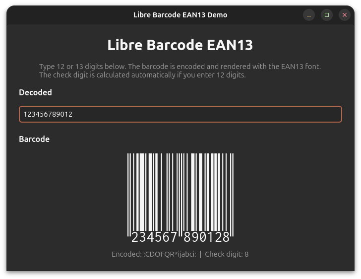

# fonts-rs-barcode-ean13

[](https://crates.io/crates/fonts-rs-barcode-ean13)
[](https://doc.rust-lang.org/edition-guide/editions/2024/)
[](https://openfontlicense.org)

Libre Barcode EAN13 font integration for GTK 4 and pixel-drawing.

## Overview

[Libre Barcode EAN13](https://github.com/graphicore/librebarcode) is a barcode
font for the EAN-13 symbology. This crate integrates it into the
`fonts-rs` framework.



## Features

- **`gtk`** (default) - GResource registration and GTK4 icon name resolution
- **`render`** - Font loading via `ab_glyph` for software rendering
- **`embed-fonts`** - Embed font file via `include_bytes!`

## Usage

```toml
[dependencies]
fonts-rs-barcode-ean13 = "0.5"
```

```rust
use fonts_rs_barcode_ean13::Ean13;

fn main() {
    Ean13::install().unwrap();
}
```

## Font License

Libre Barcode is licensed under the SIL Open Font License (OFL-1.1). The
crate code is MIT.
