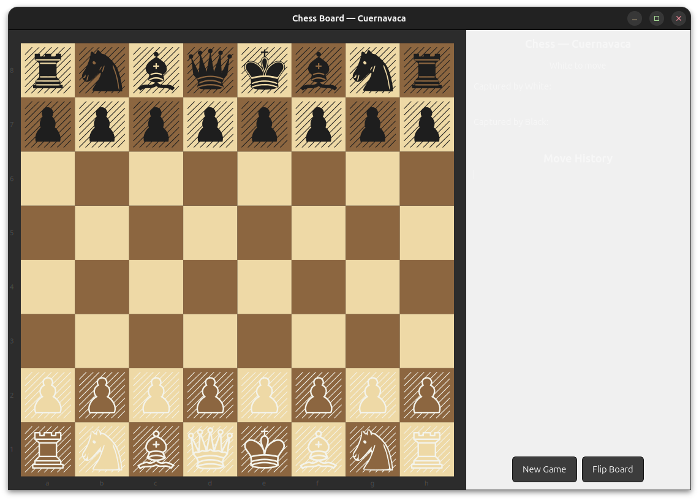

# fonts-rs-cuernavaca

Chess Cuernavaca font integration for GTK 4 and pixel-drawing.

## Overview

[Cuernavaca](https://github.com/benjaminmgross/cuernavaca) is a chess font
containing figurine glyphs for chess pieces. This crate integrates Cuernavaca
into the `fonts-rs` framework.



## Features

- **`gtk`** (default) - GResource registration and GTK4 icon name resolution
- **`render`** - Font loading via `ab_glyph` for software rendering
- **`embed-fonts`** - Embed font file via `include_bytes!`
- **`metadata`** - Piece categories and style ordering derived from the
  glyph names (`CuernavacaMetadata`)

## Character Map

Cuernavaca maps ASCII letters to chess pieces and punctuation to
diagram elements. Uppercase letters carry a piece **on a dark
square**, the same lowercase letter carries the piece **on a light
square** (no square background). The crate exports the uppercase set
only - lowercase codepoints normalize to the same glyph names.

### Pieces

| Letter | Piece | Style |
| ------ | ----- | ----- |
| `K` | king | light normal |
| `Q` | queen | light normal |
| `R` | rook | light normal |
| `B` | bishop | light normal |
| `N` | knight | light normal |
| `P` | pawn | light normal |
| `L` | king | dark normal |
| `W` | queen | dark normal |
| `T` | rook | dark normal |
| `V` | bishop | dark normal |
| `M` | knight | dark normal |
| `O` | pawn | dark normal |
| `A` | bishop | light upside-down |
| `D` | rook | light upside-down (rook+knight fairy piece) |
| `G` | knight | light upside-down |
| `S` | bishop | dark upside-down |
| `F` | rook | dark upside-down (rook+knight fairy piece) |
| `H` | knight | dark upside-down |

The upside-down glyphs are **fairy pieces** in chess-problem
convention rather than display variants: a rotated standard piece
denotes a piece with altered move rules. `G`/`H` is a generic fairy
knight (e.g. nightrider), `A`/`S` a bishop+knight compound
(archbishop), and `D`/`F` a rook+knight compound (chancellor) - the
classic set used by Carrera- and Capablanca-style variants. King,
queen, and pawn have no upside-down glyph because they carry no
canonical fairy role in that tradition.

### Squares and diagram border

| Character | Glyph |
| --------- | ----- |
| ` ` (space) | empty light square |
| `+` | empty dark square |
| `!` `"` `#` | border: top row |
| `$` | border: left side |
| `%` | border: right side |
| `/` `(` `)` | border: bottom row |

## Usage

```toml
[dependencies]
fonts-rs-cuernavaca = "0.5"
```

```rust
use fonts_rs_cuernavaca::Cuernavaca;

fn main() {
    Cuernavaca::install().unwrap();
}
```

## Font License

Cuernavaca is licensed under the SIL Open Font License (OFL-1.1). The crate
code is MIT.
