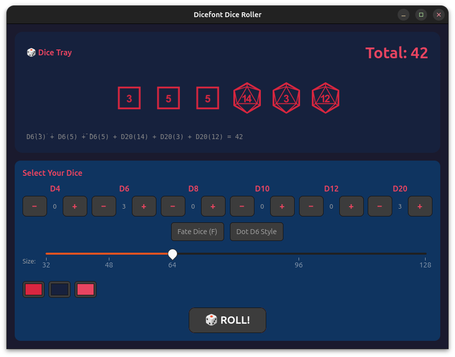

# fonts-rs-dicefont

[](https://crates.io/crates/fonts-rs-dicefont)
[](https://doc.rust-lang.org/edition-guide/editions/2024/)
[](https://openfontlicense.org)

DiceFont polyhedral dice font integration for GTK 4 and pixel-drawing.

## Overview

DiceFont is a font family containing polyhedral dice glyphs (d4, d6, d8, d10,
d12, d20) for tabletop RPG applications. This crate integrates DiceFont into
the `fonts-rs` framework.



## Features

- **`gtk`** (default) - GResource registration and GTK4 icon name resolution
- **`render`** - Font loading via `ab_glyph` for software rendering
- **`embed-fonts`** - Embed font file via `include_bytes!`

## Usage

```toml
[dependencies]
fonts-rs-dicefont = "0.5"
```

```rust
use fonts_rs_dicefont::Dicefont;

fn main() {
    Dicefont::install().unwrap();
}
```

## Font License

DiceFont is licensed under the SIL Open Font License (OFL-1.1). The crate
code is MIT.
