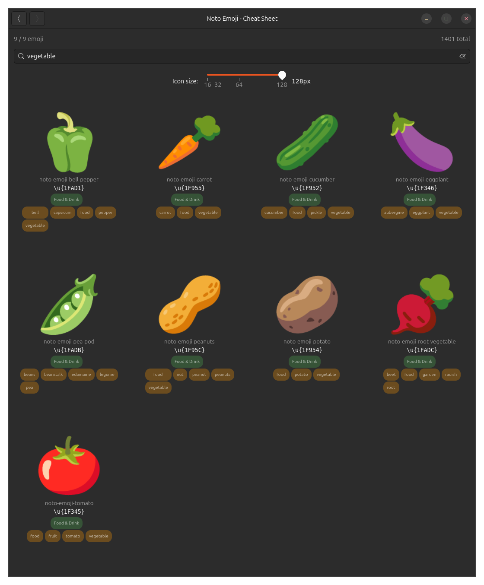

# fonts-rs-noto-emoji

Noto Emoji font integration for GTK 4 and pixel-drawing.

## Overview

[Noto Emoji](https://fonts.google.com/noto/specimen/Noto+Emoji) is Google's
emoji font. This crate integrates Noto Emoji into the `fonts-rs` framework,
with CLDR-based keyword and category metadata for search functionality.



## Variants

This is an umbrella crate. Exactly one TTF variant is selected by Cargo
feature; the active variant crate is re-exported 1:1.

| Feature | Crate | Font | `RENDERABLE` |
|---------|-------|------|--------------|
| `color-flags` (default) | `fonts-rs-noto-emoji-color-flags` | `Noto-COLRv1.ttf` | `false` |
| `color-noflags` | `fonts-rs-noto-emoji-color-noflags` | `Noto-COLRv1-noflags.ttf` | `false` |
| `bitmap-flags` | `fonts-rs-noto-emoji-bitmap-flags` | `NotoColorEmoji.ttf` | `true` |
| `bitmap-noflags` | `fonts-rs-noto-emoji-bitmap-noflags` | `NotoColorEmoji-noflags.ttf` | `true` |
| `mono` | `fonts-rs-noto-emoji-mono` | `NotoEmoji-Regular.ttf` | `true` |

Variant crates can also be used directly for smaller dependency trees.

## Features

- **Variant selection** - exactly one of `mono`, `color-flags`
  (default), `color-noflags`, `bitmap-flags`, `bitmap-noflags`;
  enabling several is a compile error
- **`gtk`** (default) - GResource registration and GTK4 icon name resolution
- **`render`** - Font loading via `ab_glyph` for software rendering
  (only `mono`/`bitmap-*` produce pixels - see `RENDERABLE`)
- **`embed-fonts`** - Embed font file via `include_bytes!`
- **`metadata`** - Emoji keywords, categories, picker ordering,
  shortcode aliases and tone groups (`emoji_17_0_ordering.json`) via
  `NotoEmojiMetadata` (`GlyphMetadata` + `GlyphOrdering`)

## Usage

```toml
[dependencies]
# Default: COLRv1 with flag emoji
fonts-rs-noto-emoji = "0.5"

# Another variant: disable defaults, then pick exactly one
fonts-rs-noto-emoji = { version = "0.5", default-features = false, features = ["gtk", "bitmap-flags"] }

# With metadata for search:
fonts-rs-noto-emoji = { version = "0.5", features = ["metadata"] }
```

```rust
use fonts_rs_noto_emoji::NotoEmoji;

fn main() {
    NotoEmoji::install().unwrap();
}
```

## Emoji ordering & metadata

With the **`metadata`** feature, `NotoEmojiMetadata` implements
`GlyphMetadata` + `GlyphOrdering` backed by build-time generated phf
tables (same sources as `fonts-rs-blobmoji`):

- **Keywords & categories** - CLDR annotations and `emoji-test.txt`.
- **Picker ordering** - `groups()`/`order_index()`/`group()` follow
  `googlefonts/emoji-metadata`.
- **Variants & tone picking** - `alternates()`/`base_of()` link skin-tone
  and ZWJ sequences to their base; `tone_group()` shares the variant
  shape for default-tone picking.
- **Shortcode aliases** - `:smile:`/emoticons resolve via
  `resolve_alias()` and hit `search()`.

## Font License

Noto Emoji is licensed under the SIL Open Font License (OFL-1.1). The crate
code is MIT.
