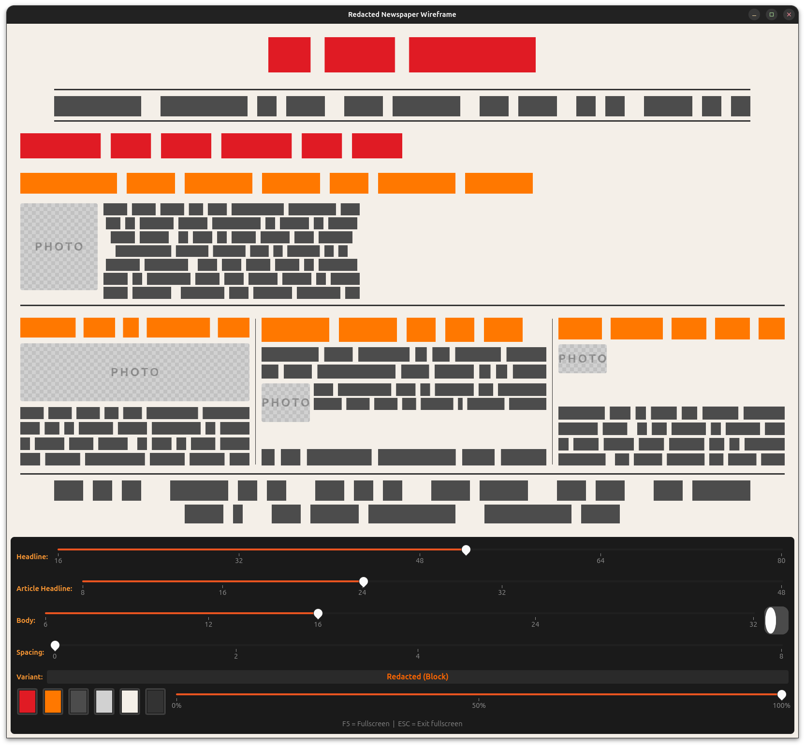

# fonts-rs-redacted

[](https://crates.io/crates/fonts-rs-redacted)
[](https://doc.rust-lang.org/edition-guide/editions/2024/)
[](https://openfontlicense.org)

Redacted placeholder text font integration for GTK 4 and pixel-drawing.

## Overview

[Redacted](https://github.com/christiannaths/Redacted-Font) is a font family
designed to look like real text but remain unreadable, useful for wireframes
and mockups. This crate integrates Redacted into the `fonts-rs` framework.



## Features

- **`gtk`** (default) - GResource registration and GTK4 icon name resolution
- **`render`** - Font loading via `ab_glyph` for software rendering
- **`embed-fonts`** - Embed font file via `include_bytes!`

## Usage

```toml
[dependencies]
fonts-rs-redacted = "0.5"
```

```rust
use fonts_rs_redacted::Redacted;

fn main() {
    Redacted::install().unwrap();
}
```

## Font License

Redacted is licensed under the SIL Open Font License (OFL-1.1). The crate
code is MIT.
