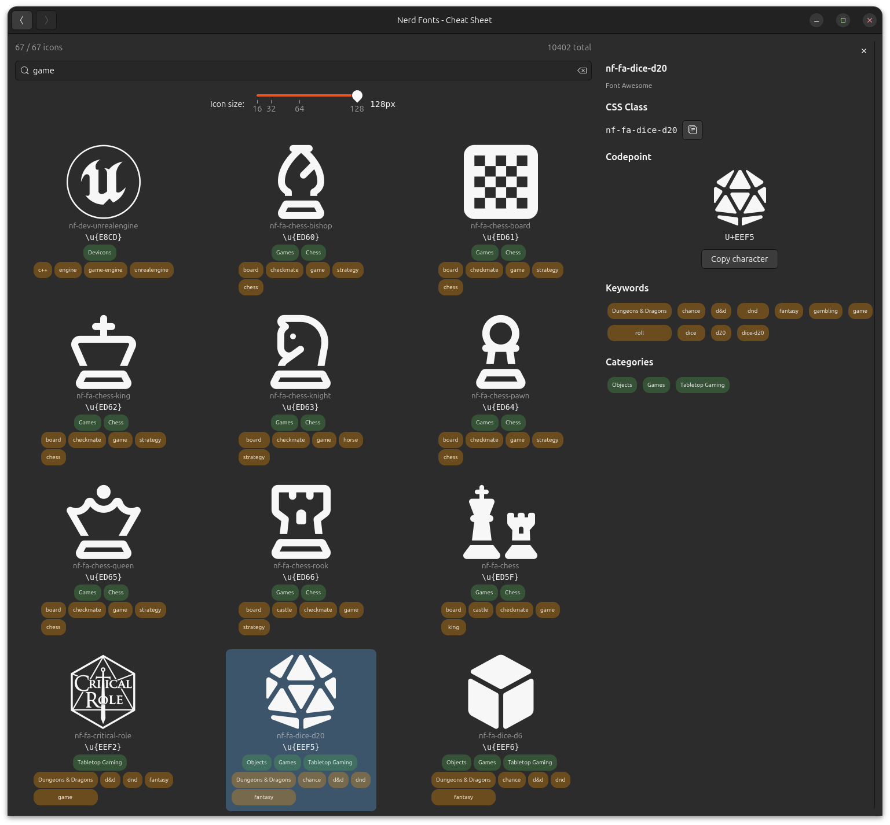

# nerd-fonts-rs

[](https://crates.io/crates/nerd-fonts-rs)
[](https://doc.rust-lang.org/edition-guide/editions/2024/)
[](https://opensource.org/licenses/MIT)

Shared Nerd Font integration for GTK4 projects: icon resolution, font
loading, and CSS generation.

## Overview

This crate provides the legacy Nerd Fonts integration API, built on top of
the `fonts-rs` framework. It bundles the Symbols Nerd Font and provides
icon name resolution, GResource registration, CSS generation, and software
rendering.



## Features

- **`gtk`** (default) - GTK4 icon name resolution, GResource registration,
  CSS providers
- **`v4_12`** - Enable GTK 4.12+ APIs (`load_from_string` for CssProvider)
- **`render`** - Font loading via `ab_glyph` for software rendering
- **`web`** - Web CSS constant with per-icon `content` mappings
- **`embed-fonts`** - Embed font files via `include_bytes!`
- **`metadata`** - Icon keywords and categories for search

## Usage

```toml
[dependencies]
nerd-fonts-rs = "0.5"
```

```rust
use nerd_fonts_rs::{init, resolve_icon_codepoint};

fn main() {
    init(None);

    if let Some(c) = resolve_icon_codepoint("nf-fa-gamepad") {
        println!("Gamepad icon: U+{:04X}", c as u32);
    }
}
```

## License

MIT. Nerd Fonts are licensed under MIT.
